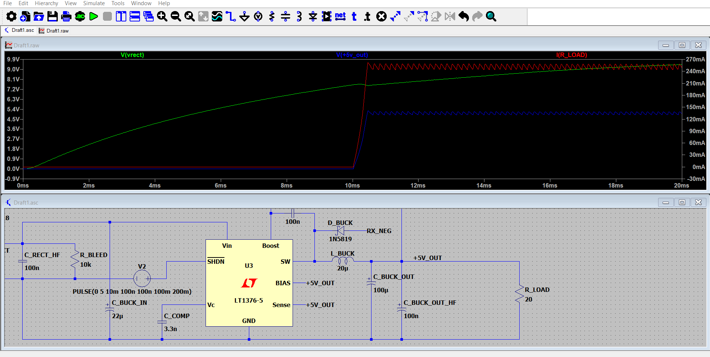

# Resonant Wireless Power Transfer: A Student Design Project

This repository documents my step-by-step development of a low-voltage resonant
inductive wireless power-transfer system. I record the theory, calculations,
LTspice models, design changes, unsuccessful trials, limitations and results so
students can reproduce the work and question the assumptions.

The original objective was 5 V at 1 A across an approximately 10 cm air gap, with
20 cm as a stretch goal. The present full-system LTspice model has **not achieved
5 V at 1 A**. The retained simulation milestone is approximately **5 V at
250 mA (1.25 W)** with a 20 ohm load and `k = 0.20`. Coupling coefficient is not
a distance measurement, so this is not proof of operation at 10 cm.

## Current full-system result

| Item | Simulated value | Status |
|---|---:|---|
| Input | 12 V DC | Simulated |
| Oscillator | 102.151 kHz | LTspice `.meas` result |
| Transmitter | One LTC4444 and two IRFH5406 models in a half bridge | Retained |
| TX resonator | 30 uH and 82 nF | Assumed |
| RX resonator | 120 uH and 20 nF | Assumed |
| Coupling | 0.20 | Assumed; not mapped to distance |
| Rectifier | Four 1N5819 models | Simulation selection |
| Regulator | LT1376-5 | Simulated |
| Accepted load | 20 ohm | About 5 V, 250 mA |
| Original load | 5 ohm | 5 V/1 A not achieved |
| Hardware result | None | Physical validation required |

Read the complete result record in
[docs/10-full-system-results.md](docs/10-full-system-results.md).

## System architecture

I retained the half bridge. One LTC4444 drives its high-side and low-side MOSFETs;
a second LTC4444 is not required. The receiver uses a full-wave Schottky bridge,
bulk filtering and an LT1376-5 buck regulator.

## Simulation startup versus hardware

The successful captured simulation used an ideal source at SHDN:

~~~spice
PULSE(0 5 10m 100n 100n 100m 200m)
~~~

This source is only a simulation aid. It lets `C_RECT` charge before the regulator
draws power. For hardware I propose:

| Part | Connection | Proposed value |
|---|---|---:|
| R_EN_HI | VRECT to SHDN | 20 kohm |
| R_EN_LO | SHDN to RX_NEG | 10 kohm |
| R_EN_FB | +5V_OUT to SHDN | 68 kohm |
| C_EN | SHDN to RX_NEG | 1 nF |

The nominal calculated thresholds are approximately 7.8 V turn-on and 6.4 V
turn-off. This UVLO network still requires LTspice and physical verification.

## Repository map

| Location | Contents |
|---|---|
| [`docs/`](docs/) | Theory, decisions, simulation procedure, results and safety |
| [`circuits/`](circuits/) | Stage 1 LTspice and SPICE files plus diagrams |
| [`results/`](results/) | Result tables, plots and student-run template |
| [`models/`](models/) | Model notes and source manifest |
| [`bom/`](bom/) | Simulation values and hardware candidates |
| [`references/`](references/) | Manufacturer references |

## Limitations

- The 250 mA point is simulated, not measured.
- `k = 0.20` has not been mapped to a coil separation.
- Coil parasitics, heating, misalignment and emissions remain incomplete.
- IRFH5406 and 1N5819 are simulation selections, not approved purchases.
- Overall efficiency has not yet been measured.
- The output is not ready for a phone or USB device.

## Project status

- [x] Resonant-link theory and reference sweep
- [x] NE555 simulation at 102.151 kHz
- [x] LTC4444 half bridge using two IRFH5406 models
- [x] Receiver bridge, filter and LT1376-5 model
- [x] Full-system run with a 20 ohm load
- [x] Record failure of the 5 V/1 A target
- [x] Define a proposed practical SHDN UVLO
- [ ] Upload the final complete `Draft1.asc` from the design computer
- [ ] Replace assumed ESR and coupling with measurements
- [ ] Verify efficiency, device loss, ripple and temperature
- [ ] Build and validate 5 V/250 mA with a current-limited supply
- [ ] Add USB compatibility only after electrical validation

## Safety

Use an isolated, current-limited 12 V bench supply. Do not connect the transmitter
to mains. Do not connect a phone while tuning. Resonance can produce coil and
capacitor voltages much higher than the supply.

Read [docs/07-lab-safety.md](docs/07-lab-safety.md) before hardware work.
