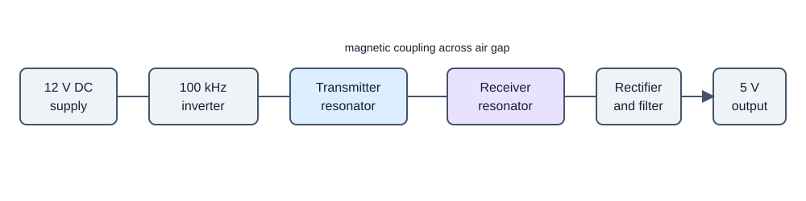

# Resonant Wireless Power Transfer: A Student Design Project

This repository documents my step-by-step development of a low-voltage resonant
inductive wireless power-transfer system. I am using it as an educational project,
so the theory, calculations, simulations, design decisions, limitations and test
results are recorded alongside the circuit files.

The first engineering target is to transfer enough power across an approximately
10 cm air gap to produce a regulated 5 V output. A 20 cm separation is an
experimental stretch goal, not a guaranteed operating point. The phone is not
connected until the receiver has been verified with an electronic or resistive
dummy load.

## Learning outcomes

Students should be able to:

1. Explain mutual inductance, coupling coefficient and resonant compensation.
2. Calculate resonant capacitance from measured coil inductance.
3. Model coupled inductors in LTspice.
4. Perform frequency and coupling-coefficient sweeps.
5. Interpret coil current, receiver voltage, load power and efficiency.
6. Recognise the differences between an ideal model and physical hardware.
7. Progress safely from a low-power resonant link to a MOSFET-driven prototype.

## Repository map

| Location | Contents |
|---|---|
| [`docs/`](docs/) | Theory, calculations, simulation instructions, safety and exercises |
| [`circuits/ltspice/`](circuits/ltspice/) | Editable LTspice schematic |
| [`circuits/spice/`](circuits/spice/) | Portable SPICE netlist |
| [`circuits/diagrams/`](circuits/diagrams/) | System and circuit diagrams |
| [`scripts/`](scripts/) | Reproducible reference-analysis and validation scripts |
| [`results/reference/`](results/reference/) | Generated reference CSV results |
| [`results/figures/`](results/figures/) | Generated plots |
| [`results/student-runs/`](results/student-runs/) | Location for measured or simulated student results |
| [`models/`](models/) | Model notes and third-party model manifest |
| [`bom/`](bom/) | Preliminary bill of materials |
| [`references/`](references/) | Datasheet and learning-resource register |

## System architecture



The project is intentionally divided into stages:

1. **Stage 1 — resonant link:** ideal sine source, two compensated coils and a
   resistive load.
2. **Stage 2 — switching transmitter:** 12 V supply, NE555 oscillator, complementary
   logic stage, LTC4444 gate driver and MOSFET half bridge.
3. **Stage 3 — receiver conversion:** tuned receiver, Schottky bridge, filter,
   protection and regulated 5 V output.
4. **Stage 4 — physical validation:** coil measurement, tuning, thermal checks,
   alignment tests and efficiency measurements.

Stage 1 has a reproducible analytical reference model. The Stage 2 and Stage 3
schematic is now being assembled in LTspice but has not yet been simulated or
validated. Later-stage components remain preliminary until block and full-system
tests are complete.

## Quick start

### LTspice

1. Open [`circuits/ltspice/01-resonant-link.asc`](circuits/ltspice/01-resonant-link.asc).
2. Run the transient analysis.
3. Plot `V(out)`, `I(L1)` and `I(L2)`.
4. Follow the detailed procedure in [`docs/04-simulation-guide.md`](docs/04-simulation-guide.md).

### Reproduce the reference frequency sweep

```bash
python scripts/simulate_resonant_link.py
```

The script uses the documented sinusoidal steady-state equations; it does not
replace LTspice. Its purpose is to give students a transparent calculation that
can be compared against a SPICE result.

## Current reference design

| Parameter | Initial value |
|---|---:|
| Source | 5 V peak sine wave |
| Frequency | 100 kHz nominal |
| Source resistance | 2.0 ohm |
| Transmitter coil | 30 microhenry, 0.3 ohm ESR |
| Receiver coil | 30 microhenry, 0.3 ohm ESR |
| Resonant capacitors | 82 nanofarad |
| Coupling coefficient | 0.02 to 0.20 sweep |
| AC load | 10 ohm |
| Calculated single-coil resonance | approximately 101.5 kHz |

## Current LTspice build checkpoint

The student schematic currently contains:

- a 12 V input, simulated fuse resistance and input decoupling;
- a nominal 100 kHz NE555 astable oscillator;
- a 2N3904 inverter that produces complementary driver inputs;
- an LTC4444 half-bridge gate driver with bootstrap supply;
- two N-channel MOSFETs with gate resistors and gate-source pull-downs;
- matched 30 microhenry/82 nanofarad transmitter and receiver resonators;
- magnetic coupling initially set to `k = 0.10`;
- a four-diode 1N5819 simulation bridge; and
- 1000 microfarad plus 100 nanofarad receiver filtering and a 10 kilohm bleeder.

The next task is to add and verify a 5 V regulator. `LT1376-5` is the present
LTspice candidate because an official model is included and it is suitable for
a 5 V, 1 A simulation. A 7805 is retained only as an optional low-current teaching
alternative because its linear-regulator loss is excessive at the 1 A target.

See [`docs/09-full-circuit-build-log.md`](docs/09-full-circuit-build-log.md) for
the exact construction sequence and the current design checks.

## Important safety boundary

This is a low-voltage educational prototype. Use a current-limited isolated DC
bench supply. Do not connect the transmitter directly to mains electricity. Do
not connect a phone while tuning the resonant circuit. Resonance can create coil
and capacitor voltages much greater than the DC supply voltage.

See [`docs/07-lab-safety.md`](docs/07-lab-safety.md) before building hardware.

## Project status

- [x] Requirements and staged architecture
- [x] Resonant-link theory and calculations
- [x] Initial LTspice schematic and portable netlist
- [x] Reproducible reference frequency sweep
- [ ] Validate Stage 1 inside LTspice and add exported waveforms
- [ ] Measure physical coil inductance, ESR and coupling
- [x] Assemble the preliminary MOSFET transmitter schematic
- [x] Assemble the receiver resonator, rectifier and filter schematic
- [ ] Add the 5 V regulator and dummy load
- [ ] Assign final MOSFET and rectifier models
- [ ] Test each circuit block in LTspice
- [ ] Validate the complete LTspice system
- [ ] Build and test the low-power prototype
- [ ] Perform phone-charging compatibility tests

## Educational use and contributions

Students are welcome to fork the repository, repeat the simulations and submit
results using the template in [`results/student-runs/`](results/student-runs/).
Please keep calculated, simulated and measured results clearly labelled.

Code is released under the MIT License. Written educational material and original
diagrams are available under CC BY 4.0; attribution is appreciated.
