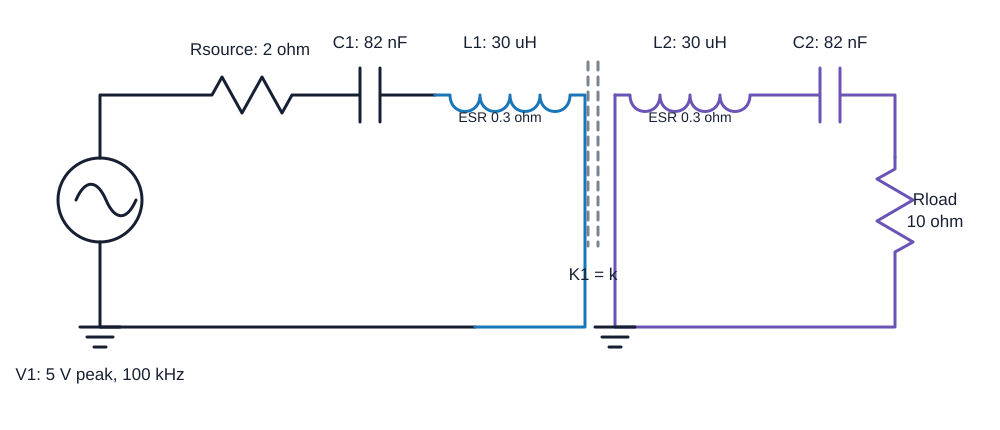

# 1. Theory of resonant inductive power transfer

## 1.1 Why a changing current is required

A current in the transmitter coil creates a magnetic field. A constant DC current
creates a stationary field after the switching transient, so it cannot continuously
induce voltage in a separate receiver coil. The transmitter therefore converts DC
into alternating current.

Faraday's law describes the induced receiver voltage:

$$
v_2(t)=-M\frac{di_1(t)}{dt}
$$

where $M$ is the mutual inductance. Increasing current amplitude or frequency can
increase the induced voltage, but also increases semiconductor switching loss,
coil loss, electromagnetic emissions and dielectric stress.

## 1.2 Mutual inductance and coupling coefficient

For transmitter inductance $L_1$, receiver inductance $L_2$ and coupling
coefficient $k$:

$$
M=k\sqrt{L_1L_2}, \qquad 0\leq k\leq1
$$

The coefficient is not simply a distance setting. It depends on separation,
diameter, alignment, orientation, turns, shielding and nearby conductive material.
For equal 30 microhenry coils and $k=0.10$:

$$
M=0.10\sqrt{30\,\mu H\times30\,\mu H}=3\,\mu H
$$

In LTspice, the coupled coils are defined by:

```spice
K1 L1 L2 {K}
```

## 1.3 Why resonance is used

The inductive reactance of a coil is:

$$
X_L=2\pi fL
$$

At 100 kHz, a 30 microhenry coil has approximately 18.85 ohm of inductive
reactance. A series capacitor contributes negative reactance:

$$
X_C=\frac{1}{2\pi fC}
$$

At series resonance, $X_L=X_C$. The inductive and capacitive terms cancel, leaving
the real losses and reflected receiver load to limit current:

$$
f_r=\frac{1}{2\pi\sqrt{LC}}
$$

For 30 microhenry and 82 nanofarad, the calculated resonance is approximately
101.5 kHz. Resonance improves power transfer, but can also cause large circulating
current and high component voltage. It does not create energy or allow efficiency
above 100%.

## 1.4 Series-series compensation

This project initially places one capacitor in series with each coil. This is
called series-series compensation.



Advantages for the first learning stage include a simple model, strong resonant
current and straightforward tuning. Limitations include sensitivity to load,
coupling and frequency, and potentially high current under poorly controlled
conditions.

## 1.5 Reflected impedance

The loaded receiver changes the impedance seen by the transmitter. In the
sinusoidal steady-state model:

$$
Z_\mathrm{in}=Z_1+\frac{(\omega M)^2}{Z_2}
$$

with:

$$
Z_1=R_s+R_{c1}+j\left(\omega L_1-\frac{1}{\omega C_1}\right)
$$

$$
Z_2=R_L+R_{c2}+j\left(\omega L_2-\frac{1}{\omega C_2}\right)
$$

At resonance, the receiver term becomes predominantly resistive. Greater coupling
can therefore increase the real load reflected into the transmitter. The effect is
central to both power transfer and transmitter protection.

## 1.6 Power and efficiency

For RMS phasor currents:

$$
P_L=|I_2|^2R_L
$$

$$
\eta=\frac{P_L}{P_\mathrm{source}}\times100\%
$$

Efficiency must be measured across clearly defined boundaries. Stage 1 considers
the compensated coils and AC load. A complete DC-to-DC efficiency measurement must
also include oscillator, gate driver, MOSFET, rectifier and regulator losses.

## 1.7 Quality factor

An unloaded series coil has an approximate quality factor:

$$
Q=\frac{\omega L}{R_c}
$$

For 30 microhenry, 0.3 ohm and 100 kHz, $Q$ is approximately 62.8. High $Q$ can
improve resonant behaviour, but narrows the useful bandwidth and increases
sensitivity to component tolerances and detuning.

