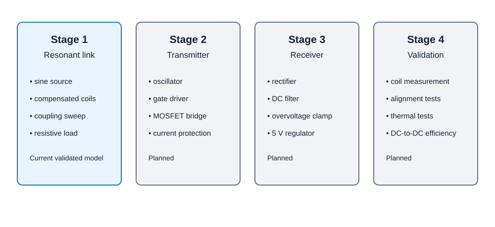

# 2. Requirements and design decisions

## 2.1 Target specification

| Requirement | Initial target | Design interpretation |
|---|---:|---|
| Input | 12 V DC | Current-limited isolated bench supply |
| Regulated output | 5 V | Verified at dummy load before USB use |
| Intended output power | up to 5 W | Later-stage target, not Stage 1 result |
| Initial distance | approximately 10 cm | Coaxial, aligned coils |
| Stretch distance | 20 cm | Expected to require larger coils or optimisation |
| Nominal frequency | 100 kHz | Starting point for learning and simulation |
| Electrical isolation | Magnetic link | No conductive connection across the air gap |

## 2.2 Why the design is staged

Building the inverter, resonant link, rectifier and regulator simultaneously would
make faults difficult to isolate. The first model uses a controlled sine source so
that resonance and coupling can be studied without MOSFET switching transients.

The design then progresses through independently testable blocks:

## 2.3 Frequency choice

One hundred kilohertz is used as an educational starting point. It is high enough
to obtain useful reactance with compact coils, while remaining convenient for
LTspice transient simulation. It is not claimed to be an optimised or standards-
compliant phone-charging frequency.

## 2.4 Coil assumptions

The preliminary model uses equal 30 microhenry coils. A possible physical starting
geometry is a flat spiral approximately 180 mm outside diameter, 80 mm inside
diameter and about 14 turns. This estimate must be confirmed using an LCR meter;
the final capacitor is selected from the measured inductance, not geometry alone.

## 2.5 Loss modelling

Each simulated coil includes 0.3 ohm equivalent series resistance. The source has
2 ohm series resistance during the first low-power exercise. These resistances
prevent an ideal, lossless resonator from producing physically meaningless current.

Real hardware will introduce additional losses from skin and proximity effects,
capacitor ESR, MOSFET conduction and switching, wiring, rectification, core or
shield losses, and regulator conversion.

## 2.6 Load choice

The Stage 1 AC load is 10 ohm. It is a convenient model for observing power transfer
but is not an exact representation of a bridge rectifier, filter capacitor, buck
converter and phone. Later stages replace it with those nonlinear blocks.

## 2.7 Success criteria for Stage 1

Stage 1 is complete when students can:

- locate the resonant-power peak;
- explain why it is near, but not necessarily exactly at, the isolated LC resonance;
- show how load power changes with coupling coefficient;
- account for source and coil loss;
- demonstrate energy conservation within numerical tolerance; and
- identify parameter assumptions that require physical measurement.

