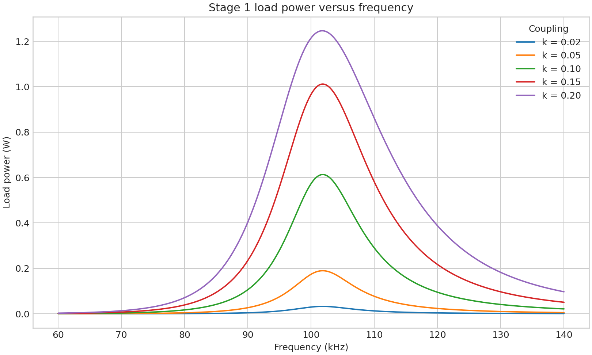
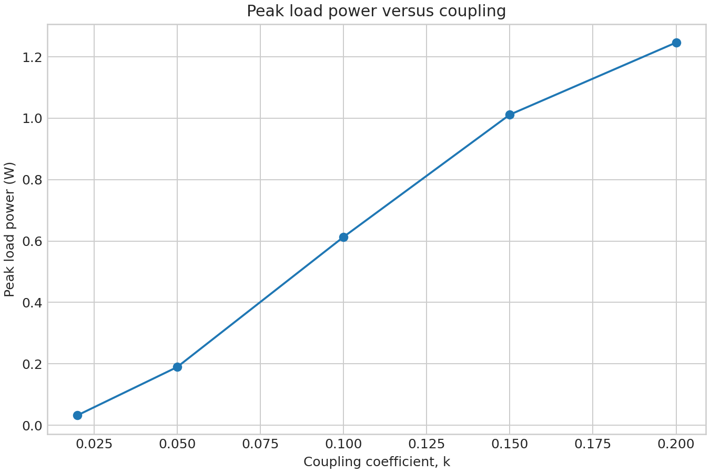

# 5. Reference simulation results

## 5.1 Status and method

These are reproducible **analytical reference-simulation results**, generated by
`scripts/simulate_resonant_link.py`. They solve the sinusoidal steady-state phasor
equations described in the theory chapter. They have not yet been validated by an
export from LTspice and must not be presented as measured hardware results.

The sweep uses 5 V peak input, 2 ohm source resistance, two 30 microhenry coils,
0.3 ohm ESR per coil, 82 nanofarad compensation capacitors and a 10 ohm load.

## 5.2 Peak load-power summary

| Coupling, k | Peak frequency (kHz) | Peak load power (W) | Primary current (A RMS) | Secondary current (A RMS) |
|---:|---:|---:|---:|---:|
| 0.02 | 101.85 | 0.0323 | 1.525 | 0.0568 |
| 0.05 | 101.85 | 0.1895 | 1.477 | 0.1376 |
| 0.10 | 101.85 | 0.6130 | 1.328 | 0.2476 |
| 0.15 | 101.85 | 1.0115 | 1.137 | 0.3180 |
| 0.20 | 101.75 | 1.2463 | 0.948 | 0.3530 |





## 5.3 Interpretation

The peak lies near 101.5 kHz, consistent with the isolated 30 microhenry and
82 nanofarad resonators. Increasing coupling raises receiver current and load power
within the simulated range. It also increases the receiver load reflected into the
primary, so primary current does not simply rise with coupling.

The 5 V peak Stage 1 source does not deliver the final 5 W target. This is
intentional: the first model demonstrates resonance at limited power. The switching
transmitter and nonlinear receiver must be designed and validated before raising
power.

## 5.4 Reproducibility

Run:

```bash
python scripts/simulate_resonant_link.py
```

The script overwrites the generated CSV and PNG files. Commit changed results only
when the model parameters or equations have intentionally changed.
