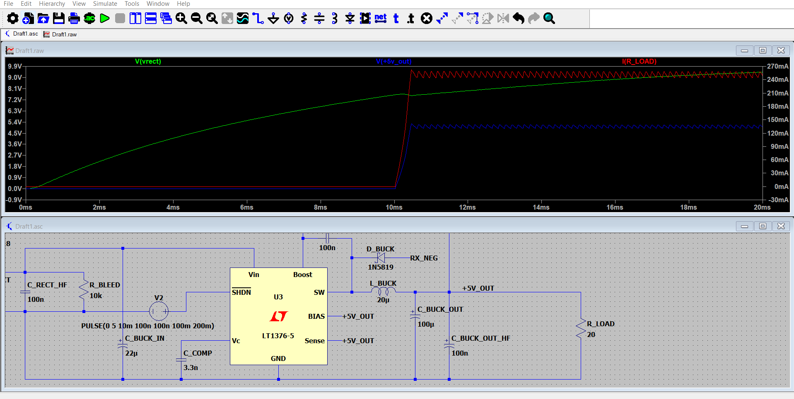

# 10. Full-system LTspice results

## 10.1 Classification

These tests were run in LTspice 26.0.2 on 3 September 2026. They are **simulated
results**, not hardware measurements. Exact values below came from the SPICE error
log; graph-read values are labelled approximate.

## 10.2 Retained circuit

| Block | Retained configuration |
|---|---|
| Supply | 12 V DC |
| Oscillator | NE555; RA 1 kohm, RB 6.8 kohm, CT 1 nF |
| Driver | One LTC4444 |
| Power stage | Half bridge; two IRFH5406 models |
| TX resonator | 30 uH, 82 nF, assumed series loss |
| RX resonator | 120 uH, 20 nF, 0.3 ohm |
| Coupling | `K1 = 0.20` |
| Rectifier/filter | Four 1N5819; 1000 uF plus 100 nF |
| Regulator | LT1376-5; 20 uH output inductor |
| Accepted load | 20 ohm |

The receiver LC resonance is approximately 102.7 kHz, close to the oscillator.

## 10.3 Oscillator result

| Measurement | Result |
|---|---:|
| Period | 9.7894 us |
| Frequency | 102.151 kHz |
| Maximum | 11.9736 V |
| Minimum | 71.35 uV |

The negative duty-cycle result previously shown was caused by a `.meas` command
that selected a falling edge before its triggering rising edge. It was a
measurement-definition error.

## 10.4 Full-system test history

| Case | Configuration/change | Result | Assessment |
|---|---|---|---|
| A | 30 uH/82 nF receiver, `k=0.10` | VRECT average 2.557 V; VOUT average 4.60 mV | Failed to start buck |
| B | Coupling increased to 0.20 | Receiver bus increased | Shows strong dependence on assumed coupling |
| C | RX 120 uH/20 nF, 20 ohm, delayed SHDN | Approximately 5 V and 0.25 A | Retained simulation milestone |
| D | 5 ohm load | Output sagged below 5 V | 5 V/1 A target failed |
| E | CT changed to 900 pF | Performance decreased | Off the loaded optimum |
| F | CT changed to 1.1 nF | VRECT about 4.5 V; regulator remained off | Reverted to 1 nF |

Case A error-log values were:

~~~text
vrect_avg = 2.55741499269 V
vrect_max = 2.596276775 V
vout_avg  = 0.0046002768675 V
~~~

For Case C, a regulated 5 V across 20 ohm gives:

- output current = 5 / 20 = 0.25 A;
- output power = 25 / 20 = 1.25 W.

The plot shows U3 enabling after approximately 10 ms. It should be followed by
automatic measurements of average output, ripple and power rather than relying
only on the plot.

## 10.5 Why 1 A was not achieved

A 5 ohm load asks for four times the current and power of a 20 ohm load at 5 V.
The rectified bus collapsed when this load was applied, so the LT1376 could not
maintain regulation. The limiting issue is available power and source impedance
of the magnetic link, not simply the regulator.

A buck regulator cannot create missing power. A future 5 W design may need better
coils, lower loss, stronger verified coupling, another compensation design or a
full-bridge transmitter. This version intentionally retains the half bridge and
uses 5 V/250 mA as its present simulation milestone.

## 10.6 SHDN implementation

The successful captured run used:

~~~spice
PULSE(0 5 10m 100n 100n 100m 200m)
~~~

That ideal source is not a practical component. The proposed hardware replacement
is 20 kohm VRECT-to-SHDN, 10 kohm SHDN-to-RX_NEG, 68 kohm
+5V_OUT-to-SHDN and 1 nF SHDN-to-RX_NEG. Nominal thresholds are about
7.8 V on and 6.4 V off.

## 10.7 Recommended final measurements

~~~spice
.options method=gear
.tran 0 40m 0 100n startup
.meas tran VRECT_AVG AVG V(VRECT) FROM 30m TO 40m
.meas tran VOUT_AVG AVG V(+5V_OUT) FROM 30m TO 40m
.meas tran VOUT_MIN MIN V(+5V_OUT) FROM 30m TO 40m
.meas tran VOUT_MAX MAX V(+5V_OUT) FROM 30m TO 40m
.meas tran IOUT_AVG AVG I(R_LOAD) FROM 30m TO 40m
.meas tran POUT_AVG AVG V(+5V_OUT)*I(R_LOAD) FROM 30m TO 40m
~~~

Check the current sign against the resistor orientation.

## 10.8 Conclusion

The model demonstrates a plausible 1.25 W operating point under an assumed
coupling coefficient of 0.20. It does not validate 5 W, a 10–20 cm distance,
efficiency, thermal performance, EMC or phone charging. Physical work should
start below 250 mA with measured coils and a current-limited supply.
